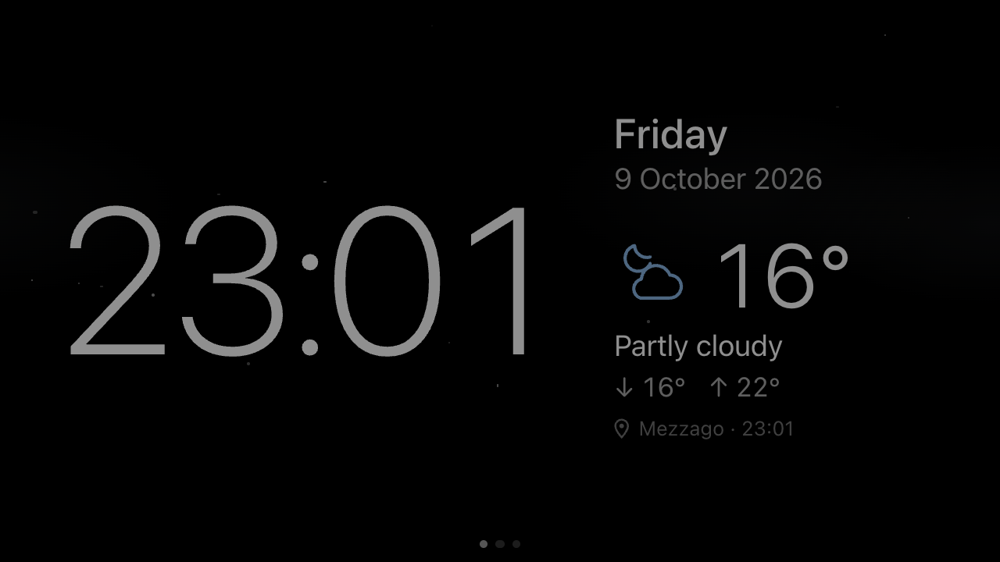
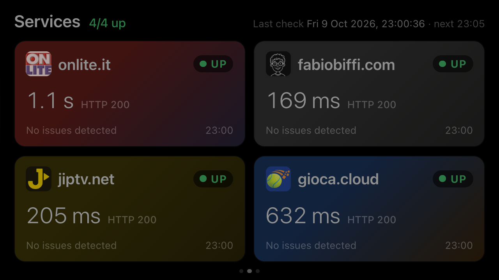
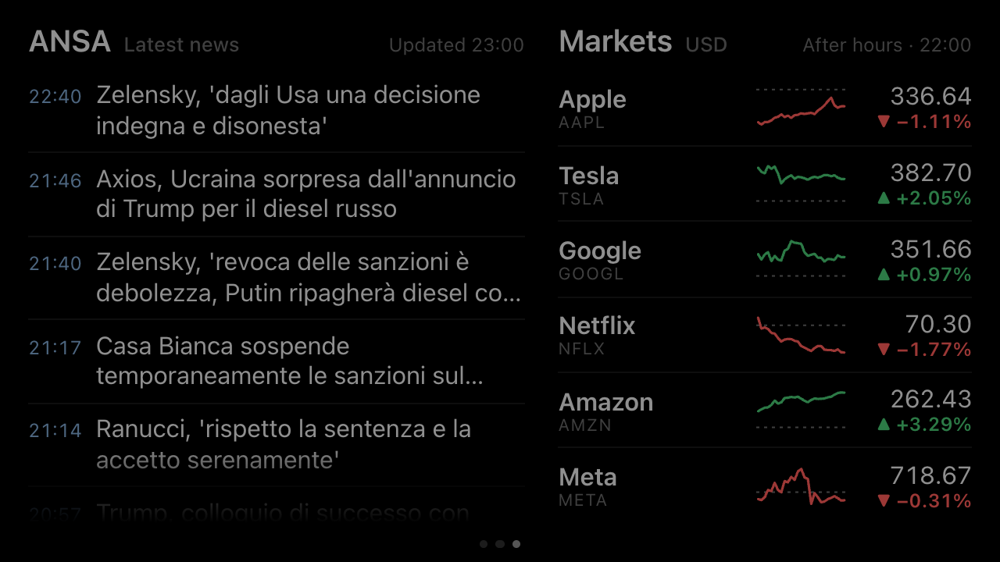
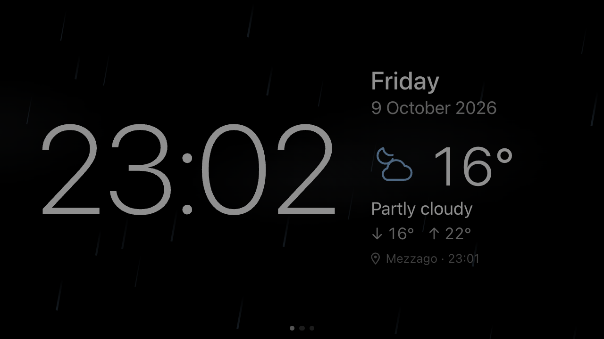

<div align="center">

# 🕰️ Clock Dashboard

**Turn an old Samsung Galaxy A5 (2015) into an always-on AMOLED smart display.**

A lightweight PWA with three swipeable dashboards: 🕒 clock & weather, 🩺 service health, 📰 news & markets.




</div>

---

## 📑 Contents

- [✨ Features](#-features)
- [📸 Screenshots](#-screenshots)
- [🚀 Quick start](#-quick-start)
- [⚙️ Configuration](#️-configuration)
- [🏗️ Architecture](#️-architecture)
- [🩺 Health checks](#-health-checks)
- [📰 News & markets](#-news--markets)
- [🎨 Designed for the device](#-designed-for-the-device)
- [📱 Installing on the Galaxy A5](#-installing-on-the-galaxy-a5)
- [🧑‍💻 Local development](#-local-development)
- [✅ Feature status](#-feature-status)
- [📝 Notes](#-notes)

---

## ✨ Features

| | Dashboard | What it shows |
|---|---|---|
| 🕒 | **Clock & weather** | 24h time, date, current weather with min/max and an animated, weather-based background |
| 🩺 | **Service health** | HTTP check every 5 minutes of `onlite.it`, `fabiobiffi.com`, `jiptv.net` and `gioca.cloud`, with toast + sound alerts when a site goes down |
| 📰 | **News & markets** | Latest ANSA “Ultima ora” (breaking news) headlines on the left; Apple, Tesla, Google, Netflix, Amazon and Meta with price, change and intraday chart on the right |

👉 Switch dashboards with a **horizontal swipe** (on desktop: **← →** arrow keys).

**Highlights**

- 🖤 **AMOLED-first**: pure black background, anti burn-in pixel shifting, visual night mode
- 📍 **Geolocated weather** with a configurable fallback location
- 🔔 **Smart alerts**: failures are double-checked before an alarm, so a flaky network doesn't trigger false ones
- 📴 **Offline-friendly**: service worker, last known data kept and clearly marked as stale
- 🪶 **Featherweight**: ~32 KB gzip of JS, Vue as the only library, zero runtime dependencies on the server

---

## 📸 Screenshots

> Captured at the device's real viewport (640×360 CSS px @ DPR 2 → 1280×720).

<table>
  <tr>
    <td align="center"><br><b>🕒 Clock & weather</b></td>
    <td align="center"><br><b>🩺 Service health</b></td>
  </tr>
  <tr>
    <td align="center"><br><b>📰 News & markets</b></td>
    <td align="center"><br><b>🌧️ Animated background</b> (<code>/?weather=rain</code>)</td>
  </tr>
</table>

---

## 🚀 Quick start

Requires **Docker**.

```bash
make dev-up-build   # build the image and start → http://localhost:8080
make dev-down       # stop
make test           # typecheck + unit tests + production build, in a container
make dev-up         # restart without rebuilding
make clean          # ⚠️ docker system prune -a --volumes: removes ALL unused images/volumes on the system
```

Then open **http://localhost:8080** 🎉

---

## ⚙️ Configuration

Set these in `docker-compose.yml`, in the environment, or in `.env`:

| Variable | Default | Meaning |
|---|---|---|
| `DASHBOARD_PORT` | `8080` | Port exposed on the host |
| `WEATHER_LOCATION_NAME` | `Mezzago` | Fallback location, used when geolocation is unavailable |
| `WEATHER_LATITUDE` / `WEATHER_LONGITUDE` | `45.62898` / `9.44485` | Coordinates for the weather |
| `HEALTH_INTERVAL_MS` | `300000` | Check interval: one round every 5 minutes (minimum 5000) |
| `HEALTH_RETRY_MS` | `30000` | Confirmation check for a service that has just failed, for that service only (`0` = disabled) |
| `NEWS_RSS_URL` | ANSA “Ultima ora” feed | RSS 2.0 news feed |
| `NEWS_SOURCE_NAME` | `ANSA` | Source name shown on screen |
| `STOCKS_REFRESH_MS` | `300000` | Quotes refresh interval (minimum 60000) |
| `CONNECTIVITY_PROBE_URL` | `https://www.cloudflare.com/cdn-cgi/trace` | Used only when *all* checks fail, to tell whether the monitor itself is offline (empty string = disabled) |

### 📍 Weather location

The app uses the **device's geolocation**:

- On first launch the browser asks for permission; HTTPS and location services enabled on Android are required.
- The position is rounded to about 1 km and re-read every 6 hours.
- The town name comes from OpenStreetMap Nominatim, queried by the server and stored.
- A 📍 pin icon appears next to the name when the weather refers to the detected position.
- If permission is denied, the position is unavailable or the page is not served over HTTPS, the fallback location **Mezzago (MB)** is used (coordinates from the Open-Meteo geocoding), which can be changed with the variables above. The coordinates of a town can be found at `https://geocoding-api.open-meteo.com/v1/search?name=<town>&language=it`.

---

## 🏗️ Architecture

```
Browser (Galaxy A5)                    Docker container (Node 24, zero runtime dependencies)
┌──────────────────────┐   /api/*     ┌───────────────────────────────────────────┐
│ Vue 3 PWA            │ ───────────▶ │ server/index.ts                           │
│ - clock (offline)    │              │  ├─ health monitor ─▶ https://onlite.it … │
│ - weather, services  │ ◀─────────── │  ├─ weather ────────▶ api.open-meteo.com  │
│ - service worker     │   dist/      │  └─ static files (dist/)                  │
└──────────────────────┘              └───────────────────────────────────────────┘
```

> 💡 **Why a small backend?** The browser cannot read the response code of third-party sites without CORS headers, and the requirements forbid disabling CORS or TLS. The server runs the checks and the frontend only reads `/api/services`. The same process serves the PWA and proxies the weather, so all the configuration lives in one place (environment variables) and there are no keys in the bundle (Open-Meteo does not require any).

### 🔌 API

| Endpoint | Content |
|---|---|
| `GET /api/services` | `HealthReport`: latest status of each service |
| `GET /api/weather[?lat=&lon=]` | `WeatherReport` for the fallback location or, with coordinates, for the given position (cached per position, town name via Nominatim) |
| `POST /api/services/:id/check` | Immediate re-check of a single configured service; returns the updated report |
| `GET /api/news` | `NewsReport`: latest news from the RSS feed (max 15) |
| `GET /api/stocks` | `StocksReport`: quotes, change and intraday series |
| `GET /api/ping` | Liveness (used by the Docker HEALTHCHECK) |

<details>
<summary>🗂️ <b>Project structure</b></summary>

```
shared/types.ts            types shared server ↔ client (statuses, reports, weather)
server/
  config.ts                ← the ONLY place to configure monitored services
  health/evaluate.ts       status rules (pure function, tested)
  health/probe.ts          HTTP request with timeout, TLS verification enabled
  health/monitor.ts        rounds of checks without overlaps
  weather.ts               Open-Meteo + cache of the last valid data
  static.ts, index.ts      static files and API
src/
  config/app.ts            client configuration (polling, night window, anti burn-in)
  core/scheduler.ts        centralized scheduler for all polling
  composables/             clock, weather, services, wake lock, viewport, display effects
  components/              swipe pager, dashboards, cards, SVG icons
  lib/                     pure logic (formatting, swipe, burn-in, weather codes)
  services/                API, localStorage, service worker registration
  styles/                  AMOLED design tokens + base styles
pwa/sw.js                  service worker template (precache list injected at build time)
tests/                     unit tests (vitest)
```

</details>

---

## 🩺 Health checks

Each service is checked **once every 5 minutes** with a `GET`: redirects are followed (e.g. `gioca.cloud` answers 301 → `/it/`, the final code counts) and the timeout is 10 s. If a check fails, **only that service** is re-checked after 30 s (`HEALTH_RETRY_MS`). Without this check, DOWN would only be confirmed after 10 minutes. The top of the dashboard shows the date and time of the last check and the time of the next one.

| Status | When |
|---|---|
| 🟢 **UP** | Expected code (200), body rule (if any) satisfied, latency ≤ 2 s |
| 🟡 **DEGRADED** | Responds as expected but is slow (> 2 s) or the body rule fails; or first failure after having been reachable, or first unexpected HTTP code (“being verified”) |
| 🔴 **DOWN** | 2 consecutive failures (unexpected code, timeout, DNS/TCP/TLS error): the first in the round, the second in the confirmation check 30 s later |
| ⚪ **UNKNOWN** | No data yet, or first network error/timeout with no history |

♿ The status is always also written as text (UP/DEGRADED/DOWN/UNKNOWN) and the shape of the indicator changes too, so color alone is never relied upon.

### 🛡️ No false alarms

To avoid mistaking a network problem for a service being down:

- **Server side**: if *all* checks fail because of a timeout or network error, the monitor checks its own connectivity (`CONNECTIVITY_PROBE_URL`, hostname-based, so it also covers DNS failures). If it is offline, each service keeps its last known status with the message “Monitor offline”, the failure is not counted and the data becomes stale.
- **Client side**: if the phone is offline or the monitor does not respond, the last known status stays visible, with a dashed border and the “Not updated” label. The same happens if a check is older than 3 intervals. The age of the check is measured only with the server's clock and that of the report only with the phone's clock, so a misaligned clock does not skew the result.

### 👆 Manual re-check

**Tap a card** to immediately re-check only that service: a small spinner appears in the card until the response arrives. It is the only action available in the dashboard, and it does not modify anything.

- If the service is already being checked (round, confirmation check or another tap), the request attaches to the one in progress instead of duplicating it.
- Repeated taps within 3 s of the last check do not trigger new calls.
- A swipe that starts on a card changes page without triggering the re-check.
- The server only accepts the `id`s present in `server/config.ts`, so it cannot be made to call arbitrary URLs.

### 🔔 Alerts (toast + sound)

When a service is confirmed **DOWN**, an alert appears at the top, above **any** dashboard (including clock and weather), with a short two-note sound synthesized via Web Audio. System notifications are not used.

- The alert stays visible as long as the service is down; tapping it hides it.
- When the service comes back online, a green alert appears for 20 seconds, with an ascending sound.
- A single failure still being verified does not trigger alerts, and neither does an unreachable monitor.
- At night the volume is lower (`alertVolume` in `src/config/app.ts`).
- 🔊 **Audio unlock**: browsers only play sounds after an interaction with the page. After each app launch **tap the screen once**. If an alert arrives before that tap, the toast signals it with *tap once to enable sound*.

### ➕ Adding a service

In `server/config.ts`:

```ts
export const SERVICES: ServiceCheckConfig[] = [
  // …
  { ...DEFAULT_CHECK, id: 'api', name: 'api.example.com', url: 'https://api.example.com/health',
    // optional: a 200 is not enough, the payload must say everything is fine
    bodyRule: { type: 'json-equals', path: 'status', expected: 'ok' } },
]
```

- 🎨 **Branding**: to give the card colors and a logo, add an entry with the same `id` in `src/config/serviceBrands.ts`: a PNG logo in `src/assets/brands/` (about 96×96), a primary color, and optionally a secondary color and a logo tile background. Without an entry the card stays neutral. The colors and logos of the 4 current sites come from the sites themselves (favicons and icons, `theme-color`, CSS). The logos are bundled, so there are no external requests and they work offline. The brand appears only as a faint reflection, a side line and the logo. The **status** is shown only by the badge and the border, so a yellow or orange brand is not mistaken for DEGRADED.
- 🔧 You can override `expectedStatus`, `timeoutMs`, `degradedLatencyMs` and `failureThreshold` per service. Then run `make dev-up-build`.
- 📐 The grid adapts by itself: 2 columns for up to 4 services, 3 columns beyond that. On this screen up to about 6 services stay readable.
- 🔒 For services reachable only on a private network or via Tailscale, the container must be able to reach them (e.g. Docker on a host that is in the tailnet). The browser never contacts them directly.

---

## 📰 News & markets

- 📜 **News scrolling**: the list scrolls vertically with a finger. A horizontal swipe still changes page even when it starts on the list. Fades at the top and bottom show there is more to scroll. After 60 s without interaction the list returns to the top, so the display always shows the latest news.
- 🗞️ **News**: the server reads the ANSA “Ultima ora” (breaking news) RSS feed every 10 minutes with a minimal dependency-free parser. Headlines are in Italian, because that is the source's content; the rest of the interface is in English. The ANSA feed is marked *for personal use only*: it is suitable for a personal dashboard, not for public use. Tapping a news item does nothing, because the display is meant to be read-only.
- 📈 **Stock market**: every 5 minutes the server reads the public, *unofficial* Yahoo Finance endpoint (`/v8/finance/chart`, no key), obtaining price, previous close, % change, market state (open, pre-market, after hours, closed) and the 15-minute intraday series.
  - In the chart, the dashed line is the previous close.
  - The change always has a sign and a ▲/▼ arrow, so it does not depend on color alone.
  - If a ticker does not respond, its last valid value is kept.
  - Since this is an unofficial endpoint, Yahoo may change or rate-limit it. In that case the dashboard shows the last known data marked *Not updated*, never made-up prices.
- 🏷️ Tickers are configured in `STOCKS` inside `server/config.ts`, using Yahoo symbols.

---

## 🎨 Designed for the device

- 📏 **Real viewport**: the 1280×720 panel at DPR 2 corresponds to about **640×360 CSS px**, minus the system bars. Sizes use a `--u` unit = 1% of the height measured via JS (`--app-h`), limited by the width at 16:9. I verified the layout at 640×360 and 640×330: no overflow and no scrolling.
- 🖤 **AMOLED**: `#000` background, `#101010` cards, colors only from CSS tokens (`src/styles/tokens.css`). No images, gradients, shadows or blur.
- 🔥 **Anti burn-in**: the content shifts by a few pixels (±6 px) every 3 minutes, along a deterministic path and with no dedicated timers.
- 🌦️ **Weather-based animated background** (clock page): sun, stars, clouds, fog, rain, snow, thunderstorm. To stay light on the Galaxy A5 it:
  - uses CSS only on `transform`/`opacity`, with at most about 40 elements;
  - uses muted tints on black;
  - pauses while you are on the services dashboard;
  - drops to half opacity at night;
  - keeps only the sun, stars and static clouds when “reduce motion” is on.

  The thunderstorm uses a slow, faint glow, never strobing flashes. To see the scenes without waiting for the right weather, open `/?weather=rain` or use `clear-day`, `clear-night`, `partly-day`, `partly-night`, `cloudy`, `fog`, `drizzle`, `snow` or `thunder`. The preview only changes the background, not the data.
- 🌙 **Visual night mode** (22:00–07:00, in `src/config/app.ts`): text and colors with reduced contrast. It does **not** change the hardware brightness.
- ⚡ **Performance**: about 32 KB gzip of JS, no library besides Vue, and system fonts (Roboto on Android). The clock updates once a minute, aligned to the minute change, and resyncs when the app returns to the foreground. All polling goes through a single scheduler, which does not overlap requests and immediately catches up on overdue tasks when the page becomes visible again or the network comes back. The dashboards stay mounted: the swipe only moves a `transform`.
- 🧭 **Navigation**: **bounded, not cyclic** (clock → services → news and markets). Beyond the edges the drag resists and bounces back. A tap or a vertical movement never changes page. Respects `prefers-reduced-motion`. The last dashboard viewed is remembered in `localStorage`.
- 🌐 **Language**: all app text is in English, with dates in `en-GB` format and 24-hour time (e.g. *Friday, 9 October 2026*). Error messages generated by the server are in English too.
- 🎯 **Build target** `chrome87`: conservative, in case the device's browser is not up to date.

---

## 📱 Installing on the Galaxy A5

### 1️⃣ HTTPS (required)

Service worker, PWA installation and Wake Lock require a **secure context**. `http://localhost` only counts on the machine itself; from the phone, `http://192.168.x.x:8080` is **not** secure. The app works, but without installation, offline support and wake lock. Options:

- 🔐 **Tailscale** (if host and phone are in the tailnet): `tailscale serve --bg 8080` on the host exposes `https://<host>.<tailnet>.ts.net` with a valid certificate.
- 🔁 An existing **reverse proxy** (Caddy, Traefik, nginx) with a valid certificate in front of port 8080.

Neither is set up here, because it depends on your infrastructure.

### 2️⃣ Install the app

1. Open the HTTPS URL in **Chrome** on the phone.
2. Menu ⋮ → **Install app** (or “Add to Home screen”).
3. Launch the app from the icon: it opens full screen (`display: fullscreen`), without the browser bar.

### 3️⃣ Recommended Android settings

- 🔌 **Stay awake while charging**: Settings → About phone → tap “Build number” 7 times → Developer options → *Stay awake*. This is the reliable way to keep the screen on. The Wake Lock API only works with the app in the foreground, and the browser may revoke it.
- 🔄 **Landscape rotation lock**: the manifest requests `orientation: landscape`, but not all browsers and ROMs honor it. Turn off auto-rotate with the phone already in landscape, or use a rotation control app.
- 🔋 **Battery optimization**: exclude Chrome so it isn't suspended.
- 💡 **Brightness**: set it manually to a low level. The app's night mode cannot change it.
- 🧱 For a true kiosk (auto-start, app pinning) you need an external solution: a kiosk launcher or, in the future, a native wrapper/TWA.

---

## 🧑‍💻 Local development

Requires **Node ≥ 24**, which runs the server's `.ts` files with native type stripping.

```bash
npm install
npm run build && npm run server   # full app on :8080
# or, with frontend hot reload:
npm run server                    # terminal 1 (API on :8080)
npm run dev                       # terminal 2 (Vite on :5173, proxy /api → :8080)
npm run typecheck && npm test
npm run icons                     # regenerate the PNG icons
```

---

## ✅ Feature status

<details open>
<summary>✔️ <b>Working and verified</b> (locally and in Docker, desktop Chrome with a simulated 640×360 viewport)</summary>

- typecheck, unit tests and production build (`make test` → exit code 0);
- container started with `make dev-up-build`, Docker healthcheck *healthy*, the 4 sites show UP (200);
- real weather from Open-Meteo;
- layout of both dashboards without overflow;
- swipe (simulated pointer events), tap ignored, keyboard navigation;
- news and markets dashboard with real data (ANSA and Yahoo Finance), by day and by night;
- manual re-check with a tap on the card (spinner, a single call) and no re-check when the swipe starts from a card;
- “monitor unreachable” state with the last known status marked as stale;
- DOWN and back-online alerts on the clock dashboard, with sounds and audio unlock on tap (DOWN simulated by intercepting the API in the browser);
- night mode;
- service worker registered, shell precache, automatic reload when a new version is released.

</details>

- 🛠️ **Requires configuration**: HTTPS (see above), and the weather location if it is not Milan.
- 📲 **To be verified on the physical device**: location permission prompt and geolocated weather; news scrolling by touch; volume and audibility of the alert sounds; actual typographic rendering and readability at a distance; touch swipe smoothness; PWA installation and `fullscreen`; whether the manifest's landscape orientation is honored; Wake Lock behavior (grant, revocation, reacquisition); operation after many hours and after standby.

---

## 📝 Notes

- ⚠️ `make test` uses `docker compose up`: the output shows the result, but the `make` command returns 0 even if the tests fail. To propagate the exit code, add `--abort-on-container-exit --exit-code-from test` in the Makefile.
- 🍎 `DOCKER_DEFAULT_PLATFORM=linux/amd64` in the Makefile: on Apple Silicon Macs the image runs under emulation (it works, but the build is slower).
